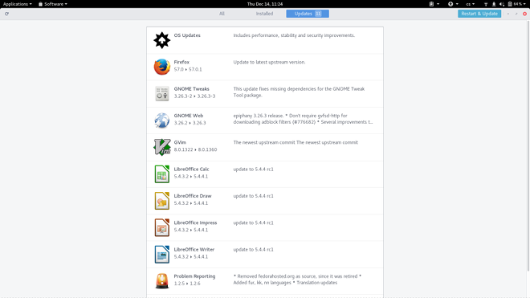

[id='manual-updating-using-gui']
= Manual updating using GUI

This section describes how to manually download and install new updates by using GUI.

[discrete]
== Procedure

. Hover the cursor over the upper-left corner of the screen and type "Software" and select the Software application to open it.

. Click the btn:[Updates] button.

. After the updates are downloaded click the btn:[Restart & Update] button.

